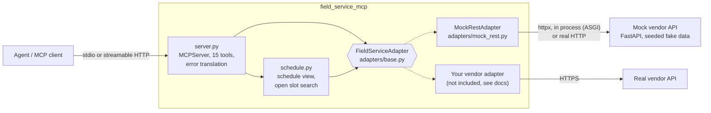

# field-service-mcp

**Lets an AI agent do office work inside a field service system: find the customer, read the technician schedule, book a visit in a free slot, and draft a quote, without double booking anyone.**

Who it is for: field service software teams, and agencies building agents for service businesses (plumbing, electrical, HVAC, handyman, property maintenance), who want an assistant to work in the system the business already uses instead of a side spreadsheet.

What it does:

- Gives the agent 15 tools for customers, jobs, visits, quotes and the schedule, over MCP (Model Context Protocol, the standard way agents such as Claude call external tools).
- Keeps vendor specifics in one adapter class, so switching field service products means writing one new class, not new tools.
- Explains failures in words the agent can act on. A double booking comes back as a message naming the clashing appointment and telling the agent to pick another time, not a stack trace.
- Has a read-only switch that removes every write tool, for the first weeks of a rollout.

**Status, stated plainly:** this is a working reference build that runs against a bundled mock vendor API with invented data. No real field service product is integrated here and the code has never called a live vendor API. See [Limitations](#limitations).

## What you will see

`python demo/run_demo.py` replays the tool calls an agent would make for this office request, with no model, no network and no keys:

> Taylor Mockwell called. The water heater still is not fixed. Get someone back out there Tuesday morning and send a quote for a new heating element.

Captured output, steps 3 to 6 of 9 (step 4 and the quote call are shortened here; the full transcript is in [demo/output.txt](demo/output.txt) and CI fails if a fresh run differs from it):

```
== Step 3: Look at Tuesday ==
  > get_schedule(date_from="2030-01-08")
    Riley Demo (T-03), 420 minutes booked
      08:00 to 10:00  Patch drywall in hallway  for Morgan Fixture
      11:00 to 16:00  Unit 2B turnover punch list  for Sample Property Group
  > find_open_slots(day="2030-01-08", duration_minutes=120, technician_id="T-01")
    open: Sam Example 08:00 to 17:00 (540 min)

== Step 4: A careless booking is refused by the vendor and explained to the agent ==
  > create_visit(job_id="WO-2004", technician_id="T-01", start="2030-01-07T14:00:00", end="2030-01-07T16:00:00")
    TOOL ERROR: Error executing tool create_visit: Tech T-01 is already booked 2030-01-07T13:00:00 to 2030-01-07T15:00:00 (appointment AP-3002). Look up the schedule or the current record, then pick different values.

== Step 5: Book the return visit in an open slot ==
  > create_visit(job_id="WO-2004", technician_id="T-01", start="2030-01-08T09:00:00", end="2030-01-08T11:00:00", notes="Return visit. Bring a replacement heating element.")
    booked AP-3008: 2030-01-08 09:00 to 11:00 tech=T-01 status=booked

== Step 6: Create the quote ==
       1 x Heating element, 4500W      $38.75
       1 x Thermostat                  $24.50
     1.5 x Labor                       $95.00
    ES-4004  status=draft  total=$205.75
```

All names, phone numbers (555-01xx), emails (example.com) and addresses are invented, and the dates are fixed in January 2030, so the output is identical on every run.

## The tools

Built on the official MCP Python SDK (version 2, `MCPServer`), with typed inputs and structured outputs:

| Area | Read | Write |
| --- | --- | --- |
| Customers | `list_customers`, `get_customer` | `create_customer` |
| Jobs | `list_jobs`, `get_job` | `create_job` |
| Visits | `list_visits` | `create_visit` |
| Quotes | `list_quotes`, `get_quote` | `create_quote` |
| Schedule | `list_technicians`, `get_schedule`, `find_open_slots` | |
| Meta | `server_info` | |

How it is put together:

- **An adapter interface** (`FieldServiceAdapter`). The tools only know vendor-neutral models. One class per vendor does the translation.
- **A mock vendor REST API** (FastAPI, seeded with invented data) that deliberately speaks a different dialect: clients, work orders, appointments and estimates, camelCase keys, money in cents, page-number paging, an API key header, and business rule errors such as double booking. The mock adapter therefore does the same kind of translation a real one would.
- **Schedule lookups computed above the adapter.** `get_schedule` and `find_open_slots` are derived from calls every adapter already has, so a new vendor gets them without extra code.
- **Errors an agent can act on.** Vendor failures are sorted into not found, invalid request, conflict, auth and upstream, and each reaches the model as a tool error that says what happened and whether retrying can help.
- **Guard rails for writes.** `FSM_READ_ONLY=true` removes the create tools entirely. Reads are retried on transient failures. Writes are never retried, because a repeated POST can create a duplicate job.

## Architecture



Source layout:

```
src/field_service_mcp/
  server.py            MCP tools and the entry point
  schedule.py          schedule and open slot logic, adapter independent
  models.py            vendor-neutral domain models (pydantic)
  errors.py            adapter error taxonomy
  config.py            settings from environment variables
  adapters/base.py     the adapter interface
  adapters/mock_rest.py  reference adapter for the mock API
  mock_api/            the fake vendor: FastAPI app and seeded store
tests/                 81 tests, all offline
demo/run_demo.py       scripted agent session, output in demo/output.txt
docs/adding-an-adapter.md
```

## Run it

Python 3.11 or newer.

```bash
python -m venv .venv && source .venv/bin/activate    # Windows: .venv\Scripts\activate
pip install -e ".[dev]"
python demo/run_demo.py
```

To serve MCP over stdio, run `field-service-mcp`. With no environment set it uses the mock API mounted in process: no port is opened and nothing leaves the machine.

Registering it with an MCP client that launches stdio servers:

```json
{
  "mcpServers": {
    "field-service": {
      "command": "/path/to/.venv/bin/field-service-mcp",
      "env": { "FSM_READ_ONLY": "true" }
    }
  }
}
```

Other ways to run:

```bash
# MCP over streamable HTTP at http://127.0.0.1:8000/mcp
MCP_TRANSPORT=streamable-http field-service-mcp

# The mock vendor API as a real HTTP server, and the MCP server pointed at it
field-service-mock-api                                   # http://127.0.0.1:8765, docs at /docs
FSM_BASE_URL=http://127.0.0.1:8765 field-service-mcp

# Seed the mock schedule around today instead of the fixed demo week
MOCK_ANCHOR_DATE=today field-service-mcp
```

If port 8765 or 8000 is taken, set `MOCK_API_PORT` or `MCP_PORT`. All settings are environment variables, listed in [.env.example](.env.example). None are required.

## Tests

```bash
pytest
```

81 tests, no network, no keys. They take roughly 10 to 15 seconds on a laptop. They cover:

- the mock API itself (auth, paging, filters, booking rules including two requests racing for one slot, totals in cents)
- the adapter (vocabulary and money mapping, offset to page translation, error translation, retry on reads and no retry on writes, using scripted HTTP transports)
- schedule and open slot logic
- the MCP surface through the SDK's own client connected in process (tool listing, schemas, structured output, tool errors, read-only mode)
- one end to end test that launches the server as a subprocess and talks to it over stdio
- a contract suite (`tests/test_adapter_contract.py`) that runs the same assertions against two different adapters (the mock one and a small in-memory one)

CI (`.github/workflows/ci.yml`) runs the tests on Python 3.11, 3.12 and 3.13, then runs the demo and diffs it against `demo/output.txt`.

## Adding a real vendor

Write one class that implements `FieldServiceAdapter`, select it with `FSM_ADAPTER=package.module:ClassName`, and run the contract tests against the vendor's sandbox. The guide, with a skeleton and the list of rules an adapter must honour, is in [docs/adding-an-adapter.md](docs/adding-an-adapter.md). The guide is written from the mock adapter; it has not been proven by building a second, real one in this repository.

## Background

The design follows agent tooling the author runs for two small service companies, where agents look up customers, check the calendar, and draft jobs and quotes in the companies' field service software. The parts kept here are the ones that proved useful there: a thin vendor-neutral tool surface, an adapter per vendor, a read-only switch for new deployments, and error messages written for the model that has to recover from them. This repository is a clean rewrite with invented data. It contains no code, configuration or records from those systems, so nothing here is evidence of them beyond the design.

## Limitations

What is mocked, and what has never been run:

- **The vendor is a mock.** The only adapter that ships talks to the bundled fake API. This code has never called a live field service product. OAuth and token refresh, rate limits (`Retry-After` is not read), webhooks and vendor quirks are all work still to do for a real integration.
- **Failure handling is tested against scripted responses only.** Timeouts, 5xx, 429 and auth errors are simulated with fake HTTP transports. How a real vendor fails has not been observed.
- **No language model is in the loop.** The demo is a fixed script and the tests use the SDK's client. Whether a given model picks the right tools, or checks open slots before booking, is not measured here.
- **Streamable HTTP is not in the test suite.** It starts and answers an MCP `initialize` request when checked by hand. The automated end to end test covers stdio only.
- **No load or performance testing** of any kind.

What the server does not do:

- **Create and read only.** There are no update, cancel, reschedule or delete tools, and no invoices, payments or line item catalogs.
- **No idempotency on writes.** Writes are not retried, but if an agent calls `create_job` twice you get two jobs. A real deployment should add idempotency keys or a duplicate check.
- **No approval step.** `FSM_READ_ONLY` is all or nothing. Tool annotations mark the create tools as writes, but whether a person confirms each write is up to the MCP client.
- **Naive local datetimes.** There is no time zone handling. A business that spans time zones needs more than this.
- **Money is a float** in major units, rounded to 2 places, converted to integer cents at the adapter. Fine for quotes of this size; an accounting-grade integration should carry decimals or cents end to end.
- **`find_open_slots` is simple.** It finds gaps inside fixed working hours, the same hours every day. It ignores travel time, skills, breaks, weekends, days off and anything that is not a visit, and it does not know the current time, so it will offer slots earlier today.
- **`get_schedule` makes one lookup per distinct job and customer** in the window, and files a visit under the day it starts. Fine for a small shop's week, slow for a large fleet without caching or a vendor batch endpoint. Schedule lookups also stop reading after 1000 visits without saying so.
- **The MCP server has no authentication of its own.** stdio inherits the trust of whoever launched it. If you expose the streamable HTTP transport beyond localhost, put authentication in front of it.
- **The mock keeps state in memory.** It resets on restart. Its double booking check is atomic inside one process, and does not hold across multiple worker processes.
- **Windows path length.** The dependencies install files up to about 120 characters below the virtual environment. On Windows without long path support, a project directory deeper than roughly 130 characters can break the install or imports. Use a shorter path or enable long paths.

License: MIT, see the LICENSE file.
