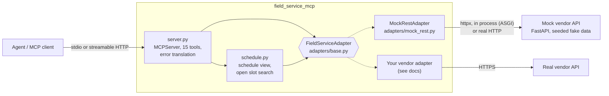

# field-service-mcp

Agents that help run a service business need to read and write the system the business actually lives in: customers, jobs, visits, quotes and the schedule.
Every field service product has a different API, so tool code written against one vendor is thrown away when the vendor changes.

This is an MCP server that exposes those operations as tools, built on a vendor adapter interface, with a bundled mock vendor API so the whole thing runs offline.

## What it does

- **15 MCP tools** over the official MCP Python SDK (version 2, `MCPServer`), with typed inputs and structured outputs:

  | Area | Read | Write |
  | --- | --- | --- |
  | Customers | `list_customers`, `get_customer` | `create_customer` |
  | Jobs | `list_jobs`, `get_job` | `create_job` |
  | Visits | `list_visits` | `create_visit` |
  | Quotes | `list_quotes`, `get_quote` | `create_quote` |
  | Schedule | `list_technicians`, `get_schedule`, `find_open_slots` | |
  | Meta | `server_info` | |

- **An adapter interface** (`FieldServiceAdapter`). The tools only know vendor-neutral models. One class per vendor does the translation.
- **A mock vendor REST API** (FastAPI, seeded with invented data) that deliberately speaks a different dialect: clients, work orders, appointments and estimates, camelCase keys, money in cents, page-number paging, an API key header, and business rule errors such as double booking. The mock adapter therefore does the same translation work a real one would.
- **Schedule lookups computed above the adapter.** `get_schedule` and `find_open_slots` are derived from calls every adapter already has, so a new vendor gets them without extra code.
- **Errors an agent can act on.** Vendor failures are sorted into not found, invalid request, conflict, auth and upstream, and each reaches the model as a tool error that says what happened and whether retrying can help.
- **Guard rails for writes.** `FSM_READ_ONLY=true` removes the create tools entirely. Reads are retried on transient failures. Writes are never retried, because a repeated POST can create a duplicate job.

## Architecture



Source layout:

```
src/field_service_mcp/
  server.py            MCP tools and the entry point
  schedule.py          schedule and open slot logic, adapter independent
  models.py            vendor-neutral domain models (pydantic)
  errors.py            adapter error taxonomy
  config.py            settings from environment variables
  adapters/base.py     the adapter interface
  adapters/mock_rest.py  reference adapter for the mock API
  mock_api/            the fake vendor: FastAPI app and seeded store
tests/                 78 tests, all offline
demo/run_demo.py       scripted agent session, output in demo/output.txt
docs/adding-an-adapter.md
```

## Run it

Python 3.11 or newer.

```bash
python -m venv .venv && source .venv/bin/activate    # Windows: .venv\Scripts\activate
pip install -e ".[dev]"
python demo/run_demo.py
```

To serve MCP over stdio, run `field-service-mcp`. With no environment set it uses the mock API mounted in process: no port is opened and nothing leaves the machine.

Registering it with an MCP client that launches stdio servers:

```json
{
  "mcpServers": {
    "field-service": {
      "command": "/path/to/.venv/bin/field-service-mcp",
      "env": { "FSM_READ_ONLY": "true" }
    }
  }
}
```

Other ways to run:

```bash
# MCP over streamable HTTP at http://127.0.0.1:8000/mcp
MCP_TRANSPORT=streamable-http field-service-mcp

# The mock vendor API as a real HTTP server, and the MCP server pointed at it
field-service-mock-api                                   # http://127.0.0.1:8765, docs at /docs
FSM_BASE_URL=http://127.0.0.1:8765 field-service-mcp

# Seed the mock schedule around today instead of the fixed demo week
MOCK_ANCHOR_DATE=today field-service-mcp
```

All settings are environment variables, listed in [.env.example](.env.example). None are required.

## Tests

```bash
pytest
```

78 tests, no network, no keys, about 15 seconds. They cover:

- the mock API itself (auth, paging, filters, booking rules, totals in cents)
- the adapter (vocabulary and money mapping, offset to page translation, error translation, retry on reads and no retry on writes, using scripted HTTP transports)
- schedule and open slot logic
- the MCP surface through a real MCP client connected in process (tool listing, schemas, structured output, tool errors, read-only mode)
- one end to end test that launches the server as a subprocess and talks to it over stdio
- a contract suite (`tests/test_adapter_contract.py`) that runs the same assertions against two different adapters

CI (`.github/workflows/ci.yml`) runs the tests on Python 3.11, 3.12 and 3.13, then runs the demo and diffs it against `demo/output.txt`.

## Demo

`python demo/run_demo.py` plays a scripted agent session with no model involved: a real MCP client connects to the server in process and makes the calls an agent would make for this request:

> Taylor Mockwell called. The water heater still is not fixed. Get someone back out there Tuesday morning and send a quote for a new heating element.

The full transcript is in [demo/output.txt](demo/output.txt). An excerpt:

```
== Step 3: Look at Tuesday ==
  > find_open_slots(day="2030-01-08", duration_minutes=120, technician_id="T-01")
    open: Sam Example 08:00 to 17:00 (540 min)

== Step 4: A careless booking is refused by the vendor and explained to the agent ==
  > create_visit(job_id="WO-2004", technician_id="T-01", start="2030-01-07T14:00:00", end="2030-01-07T16:00:00")
    TOOL ERROR: Error executing tool create_visit: Tech T-01 is already booked 2030-01-07T13:00:00 to 2030-01-07T15:00:00 (appointment AP-3002). Look up the schedule or the current record, then pick different values.

== Step 5: Book the return visit in an open slot ==
  > create_visit(job_id="WO-2004", technician_id="T-01", start="2030-01-08T09:00:00", end="2030-01-08T11:00:00", notes="Return visit. Bring a replacement heating element.")
    booked AP-3008: 2030-01-08 09:00 to 11:00 tech=T-01 status=booked
```

The seed data is invented (names such as "Alex Sample", 555-01xx phone numbers, example.com emails, a made-up town) and the dates are fixed in January 2030, so the output is identical on every run.

## Adding a real vendor

Write one class that implements `FieldServiceAdapter`, select it with `FSM_ADAPTER=package.module:ClassName`, and run the contract tests against the vendor's sandbox. The full guide, with a skeleton and the list of rules an adapter must honour, is in [docs/adding-an-adapter.md](docs/adding-an-adapter.md).

## Where this pattern runs

This is drawn from systems that run two small service companies day to day, where agents look up customers, check the calendar, and draft jobs and quotes against the companies' field service software. The parts kept here are the ones that earned their place in that use: a thin vendor-neutral tool surface, an adapter per vendor, a read-only switch for new deployments, and error messages written for the model that has to recover from them. This repository is a clean rewrite with invented data. It contains no code, configuration or records from those systems.

## Limitations

- **Only the mock adapter ships.** No real vendor has been integrated in this repository. The adapter guide describes how, but OAuth refresh, rate limit handling and vendor quirks are work you would still have to do.
- **Create and read only.** There are no update, cancel, reschedule or delete tools, and no invoices, payments or line item catalogs.
- **No idempotency on writes.** Writes are not retried, but if an agent calls `create_job` twice you get two jobs. A real deployment should add idempotency keys or a duplicate check.
- **No approval step.** `FSM_READ_ONLY` is all or nothing. Tool annotations mark the create tools as writes, but whether a person confirms each write is up to the MCP client.
- **Naive local datetimes.** There is no time zone handling. A business that spans time zones needs more than this.
- **`find_open_slots` is simple.** It finds gaps inside fixed working hours. It ignores travel time, skills, breaks, days off and anything that is not a booked visit.
- **`get_schedule` makes one lookup per distinct job and customer** in the window. Fine for a small shop's week, slow for a large fleet without caching or a vendor batch endpoint.
- **The MCP server has no authentication of its own.** stdio inherits the trust of whoever launched it. If you expose the streamable HTTP transport beyond localhost, put authentication in front of it.
- **The mock keeps state in memory.** It resets on restart, and its double booking check is not safe across multiple worker processes.
- **Windows path length.** One transitive dependency ships deeply nested data files. If the project sits in a very long directory path on Windows without long path support enabled, imports can fail. Use a short path or enable long paths.

License: MIT, see the LICENSE file.
